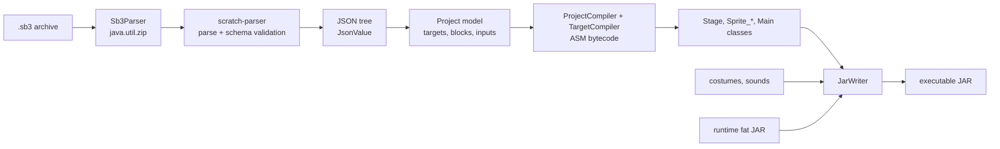
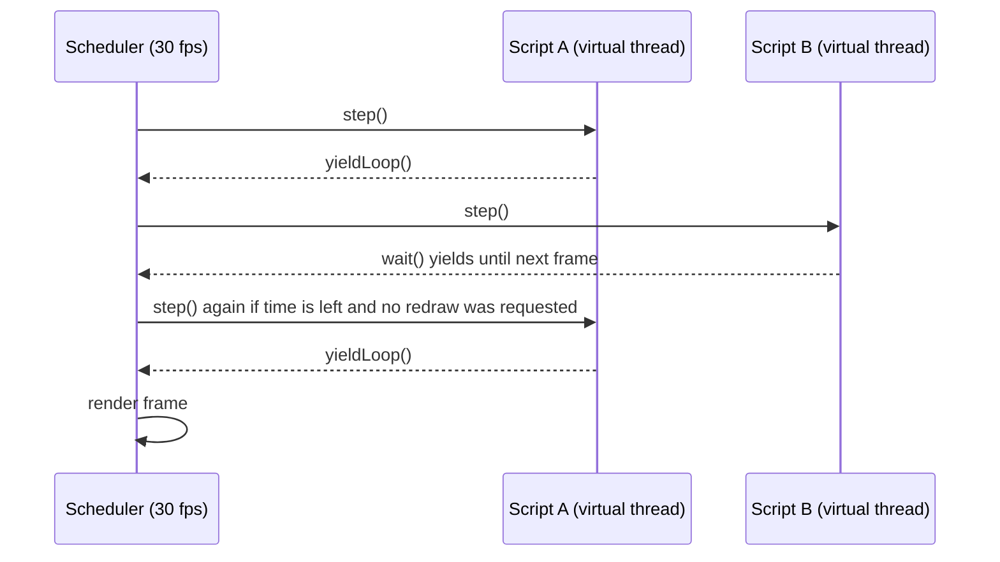
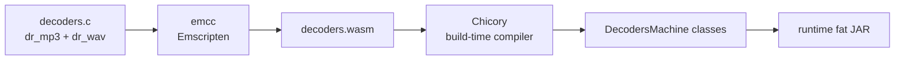
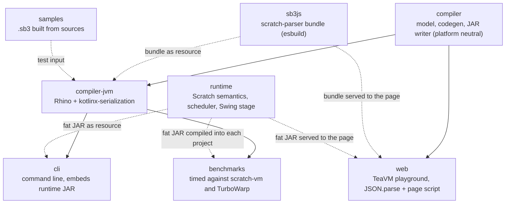

# Architecture

## Pipeline

1. **Unpacking.** `Sb3Parser` unzips the archive with `java.util.zip`, which works on the JVM and under TeaVM alike.
2. **Parsing and validation.** `project.json` goes to [scratch-parser](https://github.com/scratchfoundation/scratch-parser), the Scratch Foundation's JavaScript parser. The `sb3js` module bundles its `lib/parse` and `lib/validate` (JSON parsing with Scratch's control-character cleanup, then validation against the official sb3 JSON schema) into one script with esbuild. On the JVM that script runs inside [Rhino](https://github.com/mozilla/rhino); in the browser it is loaded by the page. The `ProjectJson` interface hides the difference.
3. **JSON.** Plain JSON (the validated project handed back by scratch-parser, and the argument lists inside custom block mutations) is parsed by kotlinx-serialization on the JVM and by `JSON.parse` in the browser. Both produce the small `JsonValue` tree in `compiler/.../json/JsonTree.kt`, which is all the model mapping sees.
4. **Model.** The tree is mapped onto the model in `Model.kt`, whose shape follows ScratchEverywhere's `sb3.cpp`: a list of targets, each with variables, lists, broadcasts, costumes, sounds and a block table keyed by block id. Inputs are decoded into literals, variable and list references, broadcast references or block references.
5. **Code generation.** `ProjectCompiler` assigns a class name per target and a field per variable. `TargetCompiler` then emits one class per target with ASM. The class extends the runtime's `Stage` or `Sprite`, and its constructor fills in position, costumes, sounds, variable values and hat registrations.
6. **JAR assembly.** `JarWriter` writes the manifest, the generated classes, list data resources, the used assets and every entry of the runtime JAR.

## Generated classes

| Scratch | JVM |
| --- | --- |
| Stage | `jscratch.project.Stage` extends `org.jscratch.runtime.Stage` |
| Sprite "Cat" | `jscratch.project.Sprite_Cat` extends `org.jscratch.runtime.Sprite` |
| Global variable | `public static Object` field on the stage class |
| Sprite variable | `public Object` field on the sprite class (clones copy it) |
| List | `ScratchList` field; large initial contents live in `data/*.txt` resources |
| Hat script | `private void script_N()` registered through `registerHat(kind, arg, N)` |
| Custom block | `private void proc_N(Object... args)`, wrapped in `enterWarp` and `exitWarp` when "run without screen refresh" is on |
| Clone support | `newInstance()` and `copyLocalsFrom(Target)` overrides |
| `sensing_of` variables | `lookupVariable(String)` override, a chain of string comparisons |

Script dispatch goes through `runScript(int)`, a `tableswitch` over the script methods. The runtime starts a script by creating a `ScriptThread` for a target and a script id, so the runtime never needs reflection or lambdas.

## Values and types

Scratch values are dynamically typed. At rest, every value is an `Object` that is a `Double`, a `String` or a `Boolean`. Expressions, however, are emitted with the static type their block naturally produces (`VType`: `NUM` as a primitive double, `STR`, `BOOL` as an int, or `ANY`) and converted at the use site through `Cast`. So `x + 1` compiles to a `DADD` on primitive doubles, while `say (x + 1)` boxes once at the call. Literals are folded into the type the consumer wants at compile time.

Comparisons use `Cast.compare`, which mirrors scratch-vm: numeric when both sides look like numbers, otherwise a case-insensitive string comparison. When both operands are statically numeric the compiler emits a direct `DCMPG` or `DCMPL` instead.

## Runtime scheduling

Scratch scripts are cooperative green threads: a script runs until it reaches a yield point (the end of a loop iteration, a `wait`, a `glide`), then the next script runs, and the stage is redrawn once per frame.

jScratch keeps that model with JVM virtual threads. Each running script is a `ScriptThread` that owns a virtual thread and two semaphores. The scheduler, which runs on one platform thread at 30 fps, hands control to a script with `step()` and blocks until the script calls `yieldNow()` or finishes. Exactly one script runs at any time and the scheduler decides the order, so generated code can be ordinary straight-line bytecode: a `forever` loop is a real loop that calls `yieldLoop()` at the end of each iteration.

Within one frame the scheduler keeps re-stepping loop-yielded scripts until 75 percent of the frame time is used or a visible change requested a redraw, which is the same rule scratch-vm applies. Scripts that waited for time (`wait`, `glide`, `say for secs`) are not re-stepped until the next frame.

Stopping a script sets a `killed` flag; the next time the script resumes it throws `StopScript`, which unwinds the virtual thread. "Run without screen refresh" increments a warp counter on the current script so yields return immediately, with the same 500 ms safety valve as Scratch.

## Rendering and input

`StageRenderer` draws a `FrameSnapshot` (the images, transforms, ghost alpha and say bubbles of every visible sprite) with Java2D. The scheduler creates a snapshot after each frame and the Swing panel paints the latest one, so painting never touches live script state. Vector costumes are rasterized once with [JSVG](https://github.com/weisj/jsvg) at twice the stage resolution. The pen is a bitmap layer between the backdrop and the sprites.

Input events from Swing are queued and applied at the start of the next frame on the scheduler thread, which is where hats are started.

## Sound

The JDK's `javax.sound` plays PCM WAV only, while projects saved by the Scratch editor mostly hold MP3, and older ones ADPCM WAV. The runtime decodes both with dr_mp3 and dr_wav, two C libraries that are compiled to JVM bytecode at build time:

At run time `SoundDecoders` creates a [Chicory](https://chicory.dev) instance of the module for each sound, copies the file into its memory and reads back 16-bit PCM, which `Sounds` plays through a `Clip`. Nothing is interpreted: every WebAssembly function is an ordinary JVM method that HotSpot compiles like any other. All sounds are decoded when the project starts, as in Scratch. A three-minute MP3 takes under a second. Headless runs decode sounds too, without playing them, so "play sound until done" waits as long as it does in a window.

## Modules

The `compiler` module depends on neither the runtime nor any JSON or JavaScript engine. It only knows the runtime's class and method names (listed in `RT` in `Names.kt`) and the `ProjectJson` interface, which is what makes the TeaVM build possible.
