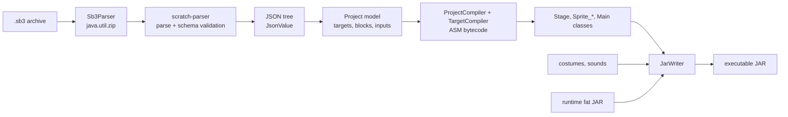
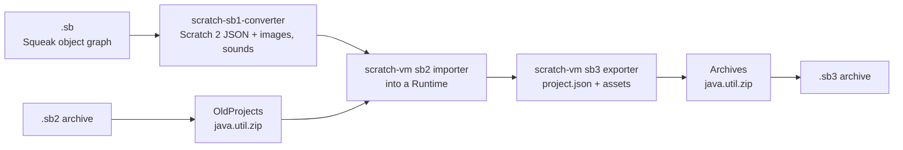
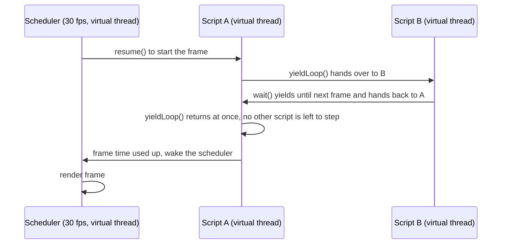
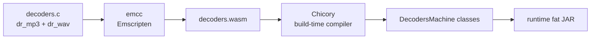
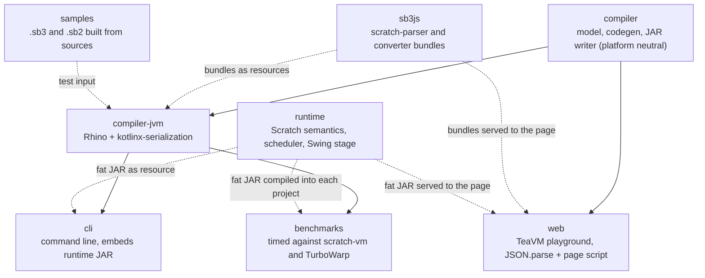

# Architecture

## Pipeline

1. **Unpacking.** `Sb3Parser` unzips the archive with `java.util.zip`, which works on the JVM and under TeaVM alike.
2. **Parsing and validation.** `project.json` goes to [scratch-parser](https://github.com/scratchfoundation/scratch-parser), the Scratch Foundation's JavaScript parser. The `sb3js` module bundles its `lib/parse` and `lib/validate` (JSON parsing with Scratch's control-character cleanup, then validation against the official sb3 JSON schema) into one script with esbuild. On the JVM that script runs inside [Rhino](https://github.com/mozilla/rhino); in the browser it is loaded by the page. The `ProjectJson` interface hides the difference.
3. **JSON.** Plain JSON (the validated project handed back by scratch-parser, and the argument lists inside custom block mutations) is parsed by kotlinx-serialization on the JVM and by `JSON.parse` in the browser. Both produce the small `JsonValue` tree in `compiler/.../json/JsonTree.kt`, which is all the model mapping sees.
4. **Model.** The tree is mapped onto the model in `Model.kt`, whose shape follows ScratchEverywhere's `sb3.cpp`: a list of targets, each with variables, lists, broadcasts, costumes, sounds and a block table keyed by block id. Inputs are decoded into literals, variable and list references, broadcast references or block references.
5. **Code generation.** `ProjectCompiler` assigns a class name per target and a field per variable, and builds the monitor table: every monitor saved in the project, plus a hidden one for each variable and list without one, so the show blocks can show any of them. `TargetCompiler` then emits one class per target with ASM. The class extends the runtime's `Stage` or `Sprite`, and its constructor fills in position, costumes, sounds, variable values and hat registrations.
6. **JAR assembly.** `JarWriter` writes the manifest, the generated classes, list data resources, the monitor table (`data/monitors.txt`, one tab-separated line per monitor), the used assets and every entry of the runtime JAR.

## Converting Scratch 1.4 and 2 projects

Projects saved by Scratch 1.4 (`.sb`) and Scratch 2 (`.sb2`) are turned into an `.sb3` before the pipeline above starts, so the compiler only ever sees Scratch 3 projects. The conversion is the Scratch Foundation's own code, the same code the Scratch 3 editor runs when it opens an old project:

`OldProjects` in the `compiler` module recognizes the old formats (a Scratch 1.4 file starts with `ScratchV0`, and a Scratch 2 `project.json` has no `targets`), unzips `.sb2` archives and zips the result. The conversion itself lives in `jscratch-convert.js`, a second bundle from the `sb3js` module. `src/convert.js` creates a scratch-vm `Runtime` without a renderer or audio engine, loads the project with scratch-vm's `sb2.deserialize`, repeats the parts of `VirtualMachine.installTargets` that matter without an editor (layer order, unique sprite names, repairing variable references) and writes the result with `sb3.serialize` and scratch-vm's asset serializer. scratch-sb1-converter first turns a Scratch 1.4 project into Scratch 2 JSON, exactly as `VirtualMachine.loadProject` does.

scratch-vm expects a browser in a few places, so the build swaps those modules for small stand-ins in `sb3js/src/headless/`:

- `load-costume.js` leaves costumes as they are, which is what scratch-vm itself does without a renderer, except that it draws a Scratch 1.4 text layer onto its costume with fast-png instead of a canvas.
- `svg-renderer.js` keeps SVG costumes byte for byte instead of sanitizing them with DOMPurify. The editor sanitizes them again if the converted project is ever opened there.
- `log.js` collects scratch-vm's warnings so the CLI and the playground can show them.
- `scratch-fetch.js` takes the place of scratch-storage's network code, since the assets always come with the project.

The build also fixes one bug: scratch-sb1-converter writes the zlib checksum at the end of every PNG little-endian instead of big-endian. Browsers never check it, but Java's ImageIO rejects such images.

The bundle returns a promise. On the JVM, `RhinoProjectConverter` runs it in Rhino and runs the queued promise jobs until it settles; nothing in it waits for a timer. Rhino lacks a few ES6 features scratch-vm relies on (classes, spread in calls, async functions, `const` in loop heads), so SWC compiles the bundle down to ES5 after esbuild bundles it. Rhino's typed arrays are also big-endian unless `Context.FEATURE_LITTLE_ENDIAN` is on. Every browser is little-endian, and scratch-sb1-converter and the MD5 code read binary data through typed arrays of different widths over one buffer, so the shared Rhino setup in `Rhino.kt` turns it on. In the browser, TeaVM code cannot wait for a promise, so the playground page calls the bundle itself between two calls into the compiler (see [Web playground](web-playground.md#how-the-page-talks-to-the-compiler)).

## Generated classes

| Scratch | JVM |
| --- | --- |
| Stage | `jscratch.project.Stage` extends `org.jscratch.runtime.Stage` |
| Sprite "Cat" | `jscratch.project.Sprite_Cat` extends `org.jscratch.runtime.Sprite` |
| Global variable | `public static Object` field on the stage class |
| Sprite variable | `public Object` field on the sprite class (clones copy it) |
| List | `ScratchList` field; large initial contents live in `data/*.txt` resources |
| Hat script | `private void script_N()` registered through `registerHat(kind, arg, N)` |
| Condition of `when timer greater than`, `when loudness greater than` and `when touching` | `hatPredicate(int)` override, a `lookupswitch` over the numbers of those scripts |
| Custom block | `private void proc_N(Object... args)`, wrapped in `enterWarp` and `exitWarp` when "run without screen refresh" is on |
| Clone support | `newInstance()` and `copyLocalsFrom(Target)` overrides |
| `sensing_of` variables | `lookupVariable(String)` override, a chain of string comparisons |
| Monitored variables and lists | `monitorSlot(int)` and `setMonitorSlot(int, Object)` overrides, a `lookupswitch` over the slot numbers in the monitor table |
| show and hide variable or list | `Runtime.setMonitorVisible(int, boolean)` with the monitor's index |

Script dispatch goes through `runScript(int)`, a `tableswitch` over the script methods. The runtime starts a script by creating a `ScriptThread` for a target and a script id, so the runtime never needs reflection or lambdas.

## Values and types

Scratch values are dynamically typed. At rest, every value is an `Object` that is a `Double`, a `String` or a `Boolean`. Expressions, however, are emitted with the static type their block naturally produces (`VType`: `NUM` as a primitive double, `STR`, `BOOL` as an int, or `ANY`) and converted at the use site through `Cast`. So `x + 1` compiles to a `DADD` on primitive doubles, while `say (x + 1)` boxes once at the call. Literals are folded into the type the consumer wants at compile time.

Comparisons use `Cast.compare`, which mirrors scratch-vm: numeric when both sides look like numbers, otherwise a case-insensitive string comparison. When both operands are statically numeric the compiler emits a direct `DCMPG` or `DCMPL` instead.

## Runtime scheduling

Scratch scripts are cooperative green threads: a script runs until it reaches a yield point (the end of a loop iteration, a `wait`, a `glide`), then the next script runs, and the stage is redrawn once per frame.

jScratch keeps that model with JVM virtual threads. Each running script is a `ScriptThread` that owns a virtual thread, and exactly one script runs at any time, so generated code can be ordinary straight-line bytecode: a `forever` loop is a real loop that calls `yieldLoop()` at the end of each iteration. The scheduler decides the order, but it is not a thread that steps the scripts one by one. When a script yields, it calls `Runtime.dispatch()`, which picks the script that comes next and resumes its thread directly, and then the yielding script parks its own thread until it is resumed. When the frame is over, the yielding script wakes the scheduler thread instead, which renders the frame and starts the next one at 30 fps. The scheduler thread is a virtual thread too, so a frame boundary is a virtual thread switch like the ones between scripts. Such a switch costs well under a microsecond. The JDK still runs virtual threads on a pool of carrier threads, though, so resuming another script can wake an idle carrier.

The common case avoids switches altogether. A frame mostly has one script that is active, looping without waiting, while every other script waits for the next frame. Once a pass ends with a single active script and no script was started or stopped during it, the scheduler knows the next passes would step that script alone. It stops scanning the list of scripts and hands each yield straight back to the same script, so the yield returns at once: it costs a few field reads and one clock read however many scripts are waiting, and a loop that yields on every iteration runs almost as fast as one that does not. Starting or stopping any script ends this, and the scheduler goes on with an ordinary pass from that point, so the order is the same as if it had scanned all along.

`dispatch()` never throws. A hat condition that fails counts as false, and a script whose thread cannot be launched is dropped, so neither can crash the script that happened to be yielding or leave the scheduler waiting for a frame that never ends.

Within one frame the scheduler keeps re-stepping loop-yielded scripts until 75 percent of the frame time is used or a visible change requested a redraw, which is the same rule scratch-vm applies. Scripts that waited for time (`wait`, `glide`, `say for secs`) are not re-stepped until the next frame.

Stopping a script sets a `killed` flag; the next time the script resumes it throws `StopScript`, which unwinds the virtual thread. "Run without screen refresh" increments a warp counter on the current script so yields return immediately, with the same 500 ms safety valve as Scratch.

Edge-activated hats (`when timer greater than`, `when loudness greater than` and `when touching`) work like they do in scratch-vm. At the start of every frame the scheduler queues a `ScriptThread` for each of these hats whose script is not already running. When the thread first steps, it calls the hat's `hatPredicate` and compares the result with the value the target kept from the last check, and only a change from false to true (or a first check that is true) runs the script. The check happens when the scheduler picks the thread, on whichever thread is choosing the next script, and a `ScriptThread` only starts its virtual thread once the script really runs, so a hat that does not fire costs one method call per frame. Each hat remembers the last thread it queued, so finding out whether its script still runs takes no search through the running scripts. Clones start with a copy of their parent's hat values, as scratch-vm's `makeClone` gives them, and the green flag forgets them all, so a condition that is already true fires again.

## Rendering and input

`StageRenderer` draws a `FrameSnapshot` (the images, transforms, ghost alpha and say bubbles of every visible sprite, and every visible monitor) with Java2D. The scheduler creates a snapshot after each frame and the Swing panel paints the latest one, so painting never touches live script state. Vector costumes are rasterized once with [JSVG](https://github.com/weisj/jsvg) at twice the stage resolution. The pen is a bitmap layer between the backdrop and the sprites.

Monitors are split the same way. `Monitor` holds the state the scripts change (visibility, and the position once placed) and reads its value from the target through `monitorSlot` or the reporter's runtime method. `MonitorView` measures each visible monitor with scratch-gui's CSS sizes, places any that were never placed with scratch-gui's `getInitialPosition`, and puts the result in the snapshot as plain data: text and its measured widths, colors and a rectangle in stage pixels, so painting measures nothing. A list monitor copies only the rows in view, already cut to fit. The window hit-tests those rectangles, so dragging a slider posts the new value to the scheduler as an event instead of writing the variable from the Swing thread, and the mouse wheel posts a scroll for a list monitor the same way.

Graphic effects other than ghost live in `Effects.kt`, a port of scratch-render's sprite shader and its CPU twin `EffectTransform`. When a target has any of them on, `EffectedCostume` draws its costume image once through the effects: for every pixel it moves the texture coordinate the way mosaic, pixelate, whirl and fisheye do, samples the premultiplied costume bilinearly with clamped edges like a WebGL texture, then applies color and brightness in HSV with scratch-render's byte rounding. The renderer and stamps use that image, and the target keeps it until the costume or an effect value changes. Clones share their parent's image until they change something. Ghost stays an alpha composite at draw time.

Collision follows scratch-render. Each costume image gets a `Silhouette`, built on first use and shared by every clone: a bit mask of its opaque pixels and the convex hull of those pixels. `touching` a sprite walks the whole stage pixels where the two sprites' bounds overlap, maps each one back into both costumes through the inverse of their render transforms, and stops at the first pixel that is opaque in both. Bitmaps are sampled by nearest neighbor; vector costumes also look at the neighboring pixels unless they are drawn upright at 100 percent, as in scratch-render. With fisheye, whirl, pixelate or mosaic on, each stage pixel is also moved through the effects before it is looked up in the costume, as scratch-render's `getLocalPosition` does. The bounds used for the edge, bouncing, fencing and say bubbles are the transformed hull, taken from the effected image when an effect moves pixels, so transparent padding never counts. Each target keeps its bounds and inverse transform until it moves, turns, changes size, rotation style or effects, or switches costume, so many clones checking `touching` against sprites that stand still do not redo the work. Fencing first compares the costume's radius around its rotation center with the distance to the stage edges, and only computes bounds when the sprite could reach the fence. With an effect that moves pixels, it uses the radius of the whole costume box instead, since those effects never move a pixel out of it, so a sprite far from the edges never has to draw its effects just to move.

Color sensing follows scratch-render's CPU path and never reads the window. It walks the whole stage pixels inside the sprite's bounds and, at each pixel where the sprite is opaque (or has the mask color for `color is touching color`), samples every other layer by nearest neighbor through the same inverse transforms and graphic effects: the visible sprites whose bounds overlap, front to back, then the pen layer, then the backdrop. The premultiplied colors are blended the way `gl.blendFunc(ONE, ONE_MINUS_SRC_ALPHA)` would, over white, rounding each channel after every step as scratch-render's byte arrays do, and the first pixel whose blend matches ends the search. The silhouette only copies a costume's colors out of its image the first time a color block needs them, and a premultiplied copy the first time a graphic effect other than ghost draws it. Costumes that use neither keep just the bit mask.

Input events from Swing are queued and applied at the start of the next frame on the scheduler thread, which is where hats are started. Dragging happens there too, as scratch-gui does it in the Scratch player: the runtime remembers where the mouse went down, picks up a draggable sprite once the mouse moved far enough or was held long enough, and moves it with the mouse once a frame, past the check that keeps scripts from moving a sprite that is being dragged.

## Sound

WAV is Scratch's default sound format. The editor saves every sound it records or edits as WAV, so an uploaded MP3 stays MP3 only until it is edited, and many library sounds and projects that started in Scratch 2 hold ADPCM WAV. The JDK's `javax.sound` plays PCM WAV only, so the runtime decodes every sound itself with dr_mp3 and dr_wav, two C libraries that are compiled to JVM bytecode at build time:

At run time a `SoundStream` is one open decoder on its own [Chicory](https://chicory.dev) instance of the module: the file is copied into the instance's memory, and the stream hands out 16-bit PCM in chunks. Nothing is interpreted: every WebAssembly function is an ordinary JVM method that HotSpot compiles like any other.

When the project starts, `Sounds` opens every sound in parallel on virtual threads to learn its length. Sounds up to 10 seconds are decoded into memory then, so they start at once. Longer ones, usually music, are decoded while they play, since a three-minute song takes about 30 MB as PCM. Each playing sound feeds its own stereo `SourceDataLine` from a daemon thread. Decoding runs at about 200 times real time, so a stream never falls behind. Headless runs only read the lengths, so "play sound until done" waits as long as it does in a window.

Volume and the sound effects are applied in software by a `Voice`, the way scratch-audio's effect chain does it in Web Audio. The pitch effect sets the playback rate (10 is a semitone), and the voice reads the sound at that rate with linear interpolation, as browsers do. Volume and pan become a two by two matrix of gains from the sound's channels to the line's: a pan other than 0 mixes the sound down to mono and spreads it with equal loudness, while a pan of 0 leaves the channels alone, because scratch-audio takes the pan node out of the chain then. When a target changes its volume or an effect, `Sounds` hands the new `SoundMix` to every voice of that target, and the gains glide to it with a time constant of 25 ms like scratch-audio's `setTargetAtTime` ramps, so nothing clicks. The voice writes chunks of 1024 frames into a line that buffers a tenth of a second, so a change is heard within about 120 ms.

Like scratch-audio's sound bank, `Sounds` keeps one `SoundPlayer` per sound of a sprite, keyed by the sprite's generated class so its clones share it. Playing a sound that is still playing stops the old voice and starts a new one, unless the same target started it in the same frame: scratch-audio leaves a sound alone for its first 25 ms, and its audio clock does not move while scratch-vm runs a frame's scripts. A stopped voice fades out over 25 ms after what its line already holds. The player also remembers whether its target played it with "play sound until done", because scratch-vm stops those sounds, and only those, when a target stops its other scripts or a clone is deleted.

Whether a sound is still playing is never asked of the audio thread. The player counts the played length on the runtime clock instead, at the rate the pitch effect gives it, starting a new stretch whenever the target changes its effects, so it works the same in headless runs and follows a pitch change in the middle of a sound. Every stop or restart bumps a counter on the player, and "play sound until done" waits until the sound has played to its end or the counter has moved.

## Modules

The `compiler` module depends on neither the runtime nor any JSON or JavaScript engine. It only knows the runtime's class and method names (listed in `RT` in `Names.kt`) and the `ProjectJson` interface, which is what makes the TeaVM build possible.
